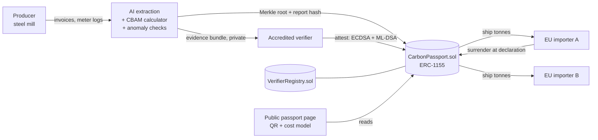

# CarbonPass

**Verified embedded-emissions passports for EU CBAM, so clean producers stop paying for dirty defaults.**

> **Track:** Carbon Markets & Emissions Transparency, IEEE ClimateChain Global Hackathon 2026
> Also touches *Sustainable Supply Chains* (digital product passports).

| | |
|---|---|
| Demo video | _TBD (YouTube link)_ |
| Live demo | _TBD (Vercel URL)_ |
| Contracts | _TBD (Sepolia addresses, see [Deployed contracts](#deployed-contracts))_ |
| Dossier (PDF) | [`docs/`](docs/) compiled into `CarbonPass-Dossier.pdf` |

---

## The problem in 30 seconds

Since **1 January 2026**, EU importers of steel, aluminium, cement, fertilisers, hydrogen and electricity pay for the carbon embedded in those goods under the **Carbon Border Adjustment Mechanism (CBAM)**. The importer is liable, but the data has to come from the producer abroad: a steel mill in Türkiye, an aluminium smelter in India.

To use **actual** emissions, that data must be checked by an accredited verifier. Without it, importers fall back to **default values plus a 10% markup in 2026**. Today the data travels as spreadsheets and PDFs over email. As a result:

- **Clean producers get no credit for being clean.** Default values ignore real performance, which removes the financial incentive to decarbonise.
- **Low-carbon claims can be counted twice.** The same verified tonnes can be promised to several buyers, or the same report reused across declarations.
- **Importers can't check what they receive.** There's no tamper-evident link between the declaration, the verifier's sign-off and the underlying evidence.
- **SMEs can't afford consultants** to produce verifier-ready data.

## What CarbonPass does

One flow, four parties:

1. **Producer** uploads energy and fuel invoices plus the production log. **AI extracts** every quantity and links it to its source document and page. A fixed calculator applies the CBAM methodology, and **statistical anomaly detection** flags anything implausible.
2. Raw data **stays private**. Only a salted **Merkle root** and a report hash go on-chain.
3. An **accredited verifier** reviews the evidence and signs twice: an ECDSA wallet signature, and a **post-quantum ML-DSA signature** so the record stays valid over long retention periods. The smart contract then **mints the batch** as ERC-1155 tonnes with a verified tCO₂e/t.
4. The producer **ships** tonnes to EU importers. The contract enforces **conservation**: verified tonnes can't be sold twice, a reporting period can't be certified twice, and an importer **surrenders** (burns) tonnes when filing a CBAM declaration so they can't be reused.
5. Anyone can scan the **passport QR code** to see the verified intensity, the verifier, the on-chain trail and the **€ saved versus default values**. They can also check that any evidence file is unchanged (tamper check).

## Why blockchain, and why AI?

| Need | Why a shared database isn't enough | What we use |
|---|---|---|
| Parties in TR / IN / EU who don't trust each other's systems | No neutral operator exists across borders | Public EVM ledger (testnet now, permissioned or L2 in production) |
| Prevent double counting of verified tonnes | This is literally the double-spend problem | ERC-1155 balances, period non-overlap, report-hash uniqueness |
| A verifier's sign-off that can't be denied later | Signatures need public, timestamped anchoring | On-chain attestation, plus a hybrid ECDSA + ML-DSA signature |
| Commercial confidentiality of plant data | Competitors must not see process data | Only salted Merkle roots on-chain; selective disclosure |
| Turn messy invoices into verifier-ready data | Manual work is the SME cost barrier | LLM extraction with source citations; a human always confirms |
| Catch bad data early | Verifiers sample and can miss things | Robust z-score and physical-bounds anomaly checks |

**Responsible AI rule:** the AI suggests and explains. It never writes to the chain. Every on-chain number is confirmed by a human and signed by an accredited verifier.

## Architecture



Full detail is in [docs/ARCHITECTURE.md](docs/ARCHITECTURE.md).

## Repository layout

```
contracts/   Solidity contracts, Hardhat tests, deploy + seed scripts
web/         Next.js app: producer, verifier, importer, public passport
data/        Demo fixtures: sample invoices, plant history, emission factors
docs/        Problem, architecture, security, impact, roadmap, demo script
design.md    Design system (DESIGN.md format) used by Claude Design + the app
```

## Quickstart

_Filled in as the build lands; see [docs/PLAN.md](docs/PLAN.md)._

```bash
pnpm install
pnpm --filter contracts test
```

## Deployed contracts

| Contract | Network | Address |
|---|---|---|
| VerifierRegistry | Sepolia | _TBD_ |
| CarbonPassport | Sepolia | _TBD_ |

## What is real vs. mocked (honest status)

| Component | Status |
|---|---|
| Smart contracts, tests, testnet deployment | _in progress_ |
| AI extraction (Claude API) | _in progress_; falls back to cached output if no API key |
| Emission factors and CBAM default values | **Illustrative.** See `data/factors.json` for sources and what to replace |
| Companies, installations, verifiers | **Fictional demo entities** |
| Party wallets | Demo custodial testnet keys (production: each party's own wallet or HSM) |

## Docs

- [Problem statement](docs/PROBLEM.md)
- [Architecture & technical spec](docs/ARCHITECTURE.md)
- [Security & data-integrity assessment](docs/SECURITY.md)
- [Climate impact assessment](docs/IMPACT.md)
- [Adoption strategy & scalability roadmap](docs/ROADMAP.md)
- [Demo video script](docs/DEMO_SCRIPT.md)
- [Research: rubric, judges, sources](docs/RESEARCH.md)

## License

MIT
