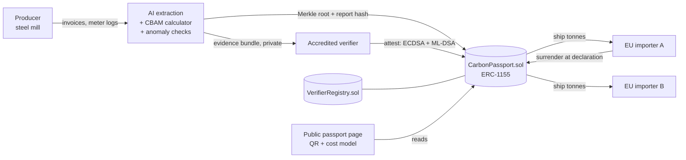

# CarbonPass

**Verified embedded-emissions passports for EU CBAM, so clean producers stop paying for dirty defaults.**

> **Track:** Carbon Markets & Emissions Transparency, IEEE ClimateChain Global Hackathon 2026
> Also touches *Sustainable Supply Chains* (digital product passports).

| | |
|---|---|
| Demo video | _TBD (YouTube link)_ |
| **Live demo** | **https://carbonpass.vercel.app** (Ethereum Sepolia testnet, no wallet needed) |
| Contracts | [CarbonPassport](https://sepolia.etherscan.io/address/0xcA4e491c54550b242f90f1c97a1C7612acf7b237) · [VerifierRegistry](https://sepolia.etherscan.io/address/0xDB123272620e734a8feEfc776aC0a40E6Baabc69), source verified on [Sourcify](https://repo.sourcify.dev/11155111/0xcA4e491c54550b242f90f1c97a1C7612acf7b237) |
| Dossier (PDF) | [`docs/CarbonPass-Dossier.pdf`](docs/CarbonPass-Dossier.pdf): problem, architecture, security, impact, roadmap |

---

## The problem in 30 seconds

Since **1 January 2026**, EU importers of steel, aluminium, cement, fertilisers, hydrogen and electricity pay for the carbon embedded in those goods under the **Carbon Border Adjustment Mechanism (CBAM)**. The importer is liable, but the data has to come from the producer abroad: a steel mill in Türkiye, an aluminium smelter in India.

To use **actual** emissions, that data must be checked by an accredited verifier. Without it, importers fall back to **default values plus a 10% markup in 2026**. Today the data travels as spreadsheets and PDFs over email. As a result:

- **Clean producers get no credit for being clean.** Default values ignore real performance, which removes the financial incentive to decarbonise.
- **Low-carbon claims can be counted twice.** The same verified tonnes can be promised to several buyers, or the same report reused across declarations.
- **Importers can't check what they receive.** There's no tamper-evident link between the declaration, the verifier's sign-off and the underlying evidence.
- **SMEs can't afford consultants** to produce verifier-ready data.

## What CarbonPass does

One flow, five parties:

1. **Producer** uploads energy and fuel invoices plus the production log. **AI extracts** every quantity and links it to its source document and page. A fixed calculator applies the CBAM methodology, and **statistical anomaly detection** flags anything implausible.
2. Raw data **stays private**. Only a salted **Merkle root** and a report hash go on-chain.
3. An **accredited verifier** reviews the evidence and signs twice: an ECDSA wallet signature, and a **post-quantum ML-DSA signature** so the record stays valid over long retention periods. The smart contract then **mints the batch** as ERC-1155 tonnes with a verified tCO₂e/t.
4. **Precursors carry their own passports.** The mill's pig iron comes from a supplier's verified batch. At issuance the contract consumes (burns) those tonnes and won't accept a steel intensity below its inputs' emissions, so embedded emissions propagate on-chain and precursor tonnes can't be claimed twice.
5. The producer **ships** tonnes to EU importers. The contract enforces **conservation**: verified tonnes can't be sold twice, a reporting period can't be certified twice, and an importer **surrenders** (burns) tonnes when filing a CBAM declaration so they can't be reused.
6. Anyone can scan the **passport QR code** to see the verified intensity, the verifier, the on-chain trail and the **€ saved versus default values**. They can also check that any evidence file is unchanged (tamper check).
7. The **[impact dashboard](https://carbonpass.vercel.app/impact)** shows what the ledger has already corrected (live from Sepolia) and scales it to an industry. Example: 5 Turkish mills save €226 M/yr by 2034, and verified data turns the value of cutting 0.1 tCO₂e/t from **€0** (default values) into **€8 M/yr**.

## Why blockchain, and why AI?

| Need | Why a shared database isn't enough | What we use |
|---|---|---|
| Parties in TR / IN / EU who don't trust each other's systems | No neutral operator exists across borders | Public EVM ledger (testnet now, permissioned or L2 in production) |
| Prevent double counting of verified tonnes | This is literally the double-spend problem | ERC-1155 balances, period non-overlap, report-hash uniqueness |
| A verifier's sign-off that can't be denied later | Signatures need public, timestamped anchoring | On-chain attestation, plus a hybrid ECDSA + ML-DSA signature |
| Commercial confidentiality of plant data | Competitors must not see process data | Only salted Merkle roots on-chain; selective disclosure |
| Turn messy invoices into verifier-ready data | Manual work is the SME cost barrier | Gemini extraction with source citations; a human always confirms |
| Catch bad data early | Verifiers sample and can miss things | Robust z-score and physical-bounds anomaly checks |

**Responsible AI rule:** the AI suggests and explains. It never writes to the chain. Every on-chain number is confirmed by a human and signed by an accredited verifier.

## Architecture



Full detail is in [docs/ARCHITECTURE.md](docs/ARCHITECTURE.md).

## Repository layout

```
contracts/          Solidity contracts (VerifierRegistry, CarbonPassport), 28 Hardhat tests, deploy script
web/                Next.js app: producer → verifier → shipments → importer → public passport
web/data/           Emission factors (factors.json), plant history, cached AI extractions
web/public/samples/ Fictional evidence PDFs (+ a tampered copy for the integrity demo)
web/scripts/        seed.ts (verified history on-chain), make-docs.ts (sample PDFs)
docs/               Problem, architecture, security, impact, roadmap, demo script
design.md           Design system (DESIGN.md format) used by Claude Design + the app
```

## Quickstart

Requires Node 22+ and pnpm.

```bash
pnpm install
pnpm test                     # 16 contract tests (conservation, overlap, self-verification, revocation, Merkle proofs)
pnpm chain                    # terminal 1: local chain (mines reverted txs like a public chain)
pnpm deploy:local             # terminal 2: deploy + accredit verifier + register installation
pnpm sync-env                 # copy demo keys + verifier PQ seed into web/.env.local
pnpm seed                     # April–June 2026 verified batches with shipments and surrenders
pnpm dev                      # http://localhost:3000
```

**Live AI extraction:** set `GEMINI_API_KEY` in `web/.env.local` (free key at aistudio.google.com/apikey). Without it, the pre-recorded sample outputs in `web/data/extractions/` are shown, and the UI says so.

**Sepolia:** fund `DEPLOYER` in `contracts/.env`, run `pnpm deploy:sepolia`, set `NETWORK=sepolia` in `web/.env.local`, then `pnpm seed`.

## Deployed contracts

| Contract | Network | Address |
|---|---|---|
| VerifierRegistry | Sepolia (11155111) | [`0xDB123272620e734a8feEfc776aC0a40E6Baabc69`](https://sepolia.etherscan.io/address/0xDB123272620e734a8feEfc776aC0a40E6Baabc69) |
| CarbonPassport | Sepolia (11155111) | [`0xcA4e491c54550b242f90f1c97a1C7612acf7b237`](https://sepolia.etherscan.io/address/0xcA4e491c54550b242f90f1c97a1C7612acf7b237) |

Both contracts are verified on Sourcify (exact match). Every attestation's ML-DSA-65 signature and the verifier's public key are in the event logs, so anyone can re-verify them from chain data alone.

**Try it on the live site:** Producer → *Load sample evidence* → *Extract* → *Confirm all* → *Calculate* → *Submit*. Then Verifier → acknowledge the flag → *Sign & issue*. Then Shipments → ship 6,000 t and 4,000 t, then try 2,000 t more and watch the contract reject it. Finally, Passports → *Verify signature*, and drop the [original](web/public/samples/electricity_invoice_2026-07.pdf) or [tampered](web/public/samples/tampered/electricity_invoice_2026-07.pdf) invoice on the tamper check. Each run certifies the next free month.

## What is real vs. mocked (honest status)

| Component | Status |
|---|---|
| Smart contracts + 28 tests | **Working**, deployed and source-verified on Sepolia |
| AI extraction | Implemented with Google Gemini (`gemini-3.5-flash-lite`, JSON-schema structured output, verbatim citations). **Without an API key the demo shows pre-recorded sample outputs, which were hand-prepared rather than produced by a live model run, and the UI says so.** |
| Anomaly checks, CBAM calculator, Merkle commitments, ML-DSA-65 signatures | **Working**, and verifiable from chain data alone |
| Emission factors and CBAM default values | Default values and mark-ups come from Implementing Reg. 2025/2621 (Türkiye HRC 2.43 tCO₂e/t, via a secondary source; check against the 2026/1740 corrections). Grid factors and plausibility bounds are **illustrative**. Every value's source is listed in `web/data/factors.json` |
| Companies, installations, verifiers | **Fictional demo entities** |
| Party wallets | Demo custodial testnet keys (production: each party's own wallet or HSM) |
| Verifier accreditation | **None.** The verifier is fictional, and a testnet passport is **not** an official CBAM declaration. The prototype demonstrates the workflow |
| Double-counting protection | Enforced by the contract **within CarbonPass**. Across other systems it needs EU / national registry integration (roadmap) |
| Climate impact | Compliance benefit: demonstrated. € benefit: calculated from published rules. Emissions cuts: modeled, to be measured in a pilot (see [IMPACT.md](docs/IMPACT.md)) |
| Post-quantum signature | Emitted on-chain and verified **off-chain** by anyone (passport page); the contract doesn't verify ML-DSA itself |

## Docs

- [Problem statement](docs/PROBLEM.md)
- [Architecture & technical spec](docs/ARCHITECTURE.md)
- [Security & data-integrity assessment](docs/SECURITY.md)
- [Climate impact assessment](docs/IMPACT.md)
- [Adoption strategy & scalability roadmap](docs/ROADMAP.md)
- [Demo video script](docs/DEMO_SCRIPT.md)
- [Research: rubric, judges, sources](docs/RESEARCH.md)

## License

MIT
