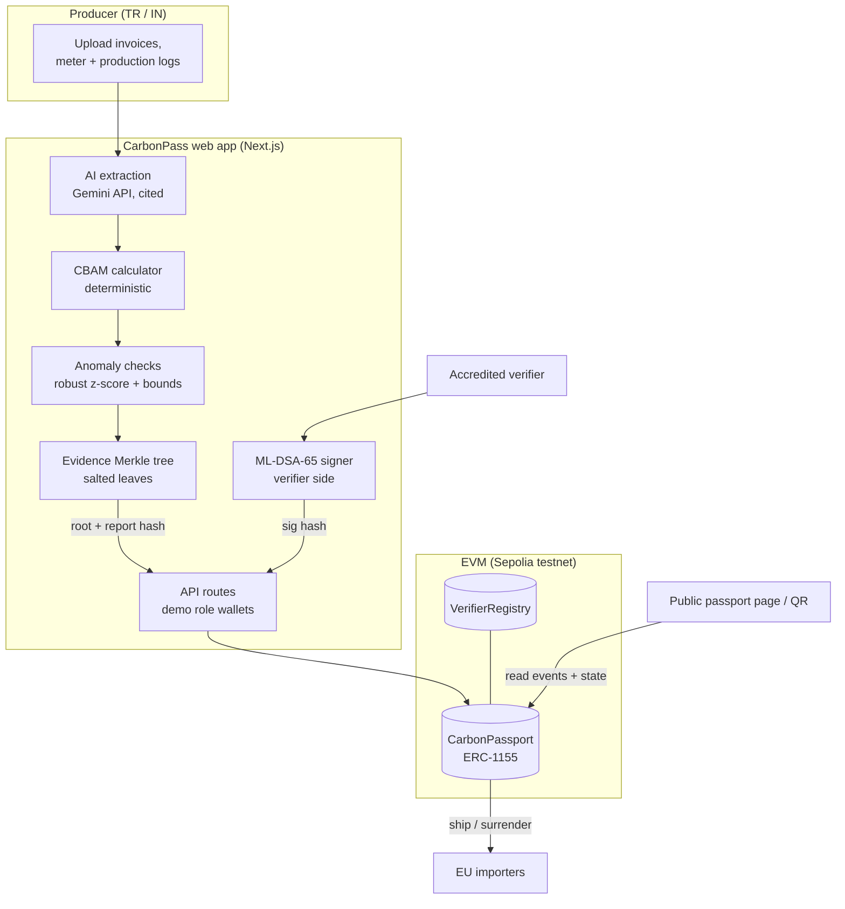
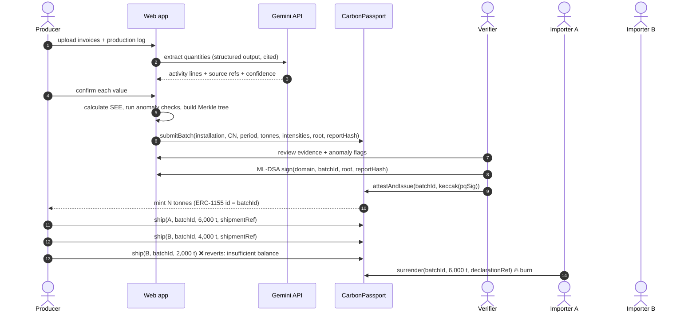
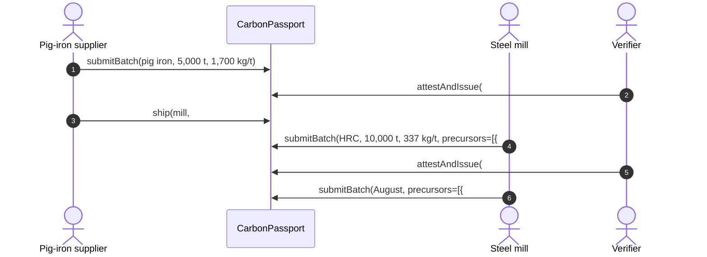

# Architecture & technical specification

## 1. System context



**On-chain:** registry of verifiers and installations, batch metadata, Merkle roots, report hashes, signature digests, tonne balances, the shipment and surrender history.
**Off-chain:** raw documents, extracted activity data, salts, the full ML-DSA signature (about 3.3 KB). The producer holds these and shares them with the verifier. Anything off-chain can be checked against the on-chain commitments.

## 2. Main sequence



### Precursor chain (embedded emissions across companies)

CBAM counts the embedded emissions of relevant precursors (e.g. pig iron in steel). A supplier with its own verified passport ships those tonnes to the mill with the normal `ship()`. The mill declares them as inputs, and they're burned when its batch is verified:



## 3. Smart contracts

Solidity 0.8.28 and OpenZeppelin Contracts 5.x. There's no ETH handling, so reentrancy has nothing to exploit.

### `VerifierRegistry`

| Function | Who | Effect |
|---|---|---|
| `accredit(verifier, name, accreditationRef, pqPublicKeyHash)` | `ACCREDITOR_ROLE` (accreditation body) | Adds or updates an active verifier |
| `revoke(verifier, reasonHash)` | `ACCREDITOR_ROLE` | Deactivates a verifier |
| `isActive(verifier) → bool` | anyone | |
| `getVerifier(verifier) → Verifier` | anyone | |

### `CarbonPassport` (ERC-1155, token id = batch id)

```solidity
struct PrecursorInput {
  uint256 batchId;           // an Issued upstream batch (e.g. pig iron)
  uint64  tonnes;            // tonnes of it embedded in this batch
}

struct Batch {
  address producer;          // installation operator
  bytes32 installationId;
  uint32  cnCode;            // e.g. 72083900 (hot-rolled flat steel)
  uint64  periodStart;       // unix seconds
  uint64  periodEnd;
  uint64  tonnes;            // product tonnes (integer)
  uint32  directKgPerT;      // kgCO2e per tonne
  uint32  indirectKgPerT;
  bytes32 dataRoot;          // Merkle root of salted evidence leaves
  bytes32 reportHash;        // sha256(canonical report JSON)
  address verifier;
  bytes32 pqSignatureHash;   // keccak256(ML-DSA-65 signature)
  uint64  submittedAt;
  uint64  issuedAt;
  uint64  surrendered;       // tonnes burned for declarations
  uint64  consumed;          // tonnes burned as a precursor of downstream batches
  Status  status;            // None, Pending, Issued, Rejected, Revoked
}
```

`BatchInput` (the `submitBatch` argument) carries the same fields plus `PrecursorInput[] precursors` (at most `MAX_PRECURSORS` = 8).

| Function | Who | Checks | Effect |
|---|---|---|---|
| `registerInstallation(id, operator, name)` | `REGISTRAR_ROLE` | | Binds an installation to its operator |
| `submitBatch(...) → batchId` | the installation's operator | reportHash unused; period valid and after the last certified period; precursors: no duplicates, each Issued and fully held by the producer, intensity covers them | `Pending`; records the precursor claim (`PrecursorDeclared`), burns nothing |
| `attestAndIssue(batchId, pqSigHash)` | an active verifier | pending; verifier ≠ producer; period still free; precursor checks again | `Issued`; burns each precursor's tonnes from the producer (`PrecursorConsumed`), then mints `tonnes` to the producer |
| `rejectBatch(batchId, reasonHash)` | an active verifier | pending | `Rejected` |
| `ship(to, batchId, tonnes, shipmentRef)` | holder | balance ≥ tonnes; batch not revoked | Transfer + `Shipped` event |
| `surrender(batchId, tonnes, declarationRef)` | holder | balance ≥ tonnes | Burn + `Surrendered` event |
| `revokeBatch(batchId, reasonHash)` | issuing verifier or registrar | issued | `Revoked`; all transfers and burns frozen |
| `verifyDisclosure(batchId, key, value, unit, salt, proof) → bool` | anyone (view) | | Merkle inclusion against `dataRoot` |
| `getPrecursors(batchId) → PrecursorInput[]` | anyone (view) | | The inputs a batch declared; burned once it's Issued |

**Precursor errors:** `InsufficientPrecursor(precursorId, held, needed)`, `PrecursorNotIssued(precursorId, status)`, `UnderstatedPrecursors(declaredKg, precursorKg)`, `DuplicatePrecursor(precursorId)`, `TooManyPrecursors(count, max)`.

Every precursor check runs at submit, so the producer finds out immediately. The checks run again at issuance, which is the authoritative point: a precursor can be revoked, or its tonnes moved, while the claim is pending. Submitting the claim is the producer's consent to the burn. Only the installation's operator can submit, and tonnes are only ever burned from that operator's balance. Precursors are burned *before* the downstream mint, so a contract producer's `onERC1155Received` hook can't move them away mid-issuance.

**Invariants** (covered by tests):

1. `totalSupply(id) + surrendered(id) + consumed(id) == tonnes(id)` for every issued batch, so tonnes are never created after issuance. A seeded random sequence of ships, claims, issuances, rejections and surrenders checks this, and that holder balances sum to the supply, after every step.
2. A `reportHash` can be used at most once.
3. For each installation and CN code, certified periods never overlap.
4. A producer can never verify its own batch. Only active accredited verifiers can issue.
5. A revoked batch can't move, and can't be consumed as a precursor.
6. **Precursor tonnes count once across companies.** They're burned exactly when the consuming batch is issued. A pending or rejected batch burns nothing. Consumed tonnes can never back a second batch.
7. **Embedded emissions can't be understated:** `directKgPerT × tonnes ≥ Σ precursor.tonnes × precursor.directKgPerT` (integer form, no rounding). Precursor intensities are immutable once issued.
8. **The supply-chain graph is acyclic:** a precursor must already be Issued when the claim is submitted, so its id is always lower than the batch consuming it.

## 4. Evidence commitment

**Leaves:** `[key, value, unit, salt]`, encoded as `(string, string, string, bytes32)` in an OpenZeppelin `StandardMerkleTree`. Each leaf is `keccak256(bytes.concat(keccak256(abi.encode(...))))`. Examples:

| key | value | unit |
|---|---|---|
| `fuel.natural_gas` | `118400` | `GJ` |
| `electricity.grid` | `46250` | `MWh` |
| `input.electrodes` | `172` | `t` |
| `production.hrc` | `10000` | `t` |
| `doc.gas_invoice_2026-07.pdf` | `<sha256 hex>` | `sha256` |

- **Salt:** a random 32 bytes per leaf. Activity values have low entropy, and without salts someone could brute-force a leaf.
- **Tamper check:** a file dropped on the passport page is re-hashed (SHA-256). It matches only if a `doc.*` leaf with that hash proves into `dataRoot`.
- **Report hash:** SHA-256 of the canonical JSON report (sorted keys, no whitespace).

## 5. Hybrid verifier signature

- **ECDSA (secp256k1):** the verifier's transaction calling `attestAndIssue`. It's native and gives immediate non-repudiation.
- **ML-DSA-65 (FIPS 204)** via `@noble/post-quantum`. The message is the domain-separated tuple `("CarbonPass/v1", chainId, contract, batchId, dataRoot, reportHash)`. The signature is stored off-chain, and `keccak256(sig)` goes on-chain. The verifier's PQ public-key hash is registered in `VerifierRegistry`.
- **Why:** CBAM and ETS records must stay attributable for years. Hybrid signing keeps attestations unforgeable even if secp256k1 is broken during that period. It's crypto-agile: the scheme is versioned in the domain tag.

## 6. CBAM calculation (simplified, in `web/lib/cbam.ts`)

```
direct_t   = Σ fuel_GJ × EF_fuel (tCO2/GJ)  +  Σ process_input_t × EF_input (tCO2/t)
indirect_t = electricity_MWh × grid_EF (tCO2/MWh)
SEE_direct   = direct_t / production_t          (tCO2e per t product)
SEE_indirect = indirect_t / production_t
chargeable   = SEE_direct (+ SEE_indirect for cement, fertilisers)
cbam_cost(y) = tonnes × chargeable × CBAM_factor(y) × EU_ETS_price
default_cost(y) = tonnes × default_value × (1 + markup(y)) × CBAM_factor(y) × EU_ETS_price
```

All factors live in `web/data/factors.json`, each with a source and a verify note. Purchased pig iron is included as a **precursor** (`precursor_t × SEE_precursor`, added to direct). When the mill holds a verified pig-iron passport, `SEE_precursor` is that passport's on-chain intensity, and Submit declares the tonnes so the contract burns them at issuance. Otherwise it falls back to the EU default value (1.85 tCO₂e/t for Türkiye). In the demo, 1,300 t at a verified 1.700 instead of 1.85 takes July from 0.356 to 0.337 tCO₂e/t. Only direct precursor emissions are enforced on-chain, because direct emissions are the chargeable scope for iron and steel. The evidence report commits to the precursor claim, so the verifier's signature covers it.

## 7. Anomaly checks (in `web/lib/anomaly.ts`)

- **Robust z-score** against the installation's 12-month history: `z = 0.6745 × (x − median) / MAD`. Flag if |z| > 3.5. This is Iglewicz & Hoaglin's modified z-score.
- **Physical bounds** per route, e.g. EAF electricity 0.35–0.75 MWh/t. Out of range means a flag.
- **Cross-document consistency:** e.g. the invoiced MWh vs. the meter log, flagged above 2% difference.
- Flags are advisory. The verifier must acknowledge each one before signing.

## 8. AI extraction (in `web/app/api/extract`)

- The Gemini API (Interactions API, `gemini-3.8-flash`, free tier) gets each PDF and a **JSON schema** (generated from a Zod schema) for the output. Each line has: `{ key, value, unit, period, source: { file, page, quote }, confidence }`.
- Documents are treated as untrusted data. The model has no tools, and its output is validated against the schema and unit whitelist.
- Without an API key, pre-recorded sample outputs in `web/data/extractions/` are returned (hand-prepared, labelled as such in the UI), so the demo always works.

## 9. Web app

| Route | Role | Purpose |
|---|---|---|
| `/` | public | Problem, live chain stats, start demo |
| `/producer` | producer | Evidence upload → extraction → calculation → checks → submit |
| `/verifier` | verifier | Queue → evidence + flags → sign → issue (stamp) |
| `/shipments` | producer | Tonnage gauge, ship to A / B, over-ship revert |
| `/importer` | importer | Holdings, surrender at declaration |
| `/passport/[id]` | public | QR, intensity, verifier, precursors + supply-chain graph, timeline, tamper check, cost model |

API routes (`/api/tx/*`) sign with **demo role wallets** held as server env vars on testnet. In production each party signs with its own wallet or HSM. The UI shows the acting address on every action.

## 10. Public-RPC consistency (read-your-writes)

Free Sepolia RPCs are load-balanced, so a read right after a write can hit a node a block behind. Two problems follow: "batch doesn't exist" errors, and false "insufficient balance" predictions. The app handles this:

- Simulation and gas estimation are **pinned to the newest block known to contain our own writes**. The browser passes its last-seen block as `minBlock`.
- Lag-type reverts (`UnknownBatch`, `NotPending`) are retried briefly.
- For forced on-chain sends, the **receipt is the source of truth**, never the prediction.
- Nonces are tracked per role, so a stale node can't hand back an old nonce.

## 11. Deployment

- **Contracts:** Hardhat, `pnpm --filter contracts deploy:sepolia`, then source verification on Etherscan.
- **Seed:** register the verifier and both installations (the steel mill and its pig-iron supplier), plus 3 historical issued steel batches (so the passport timeline and history aren't empty), and the supplier's June 2026 pig-iron batch (#4, 5,000 t at 1,700 kgCO₂e/t) with 1,300 t shipped to the mill for the July demo.
- **Web:** Vercel (https://carbonpass.vercel.app). Env vars: `NETWORK`, `RPC_URL`, demo role keys, `VERIFIER_PQ_SEED`, optional `GEMINI_API_KEY` / `GEMINI_MODEL`. Contract addresses come from `web/lib/chain/deployments.json`.
